# Architecture: live telemetry data flow

How a sensor reading travels from an ESP32 (or the simulator) to a component. Code lives in `src/features/telemetry` (public API: `index.ts`), and every limit is in `config.ts`. Decisions: ADR 0010 (transports), ADR 0011 (protocol), ADR 0012 (ring buffers), ADR 0013 (state libraries), ADR 0014 (batching).

```mermaid
flowchart LR
  subgraph Sources
    ESP[ESP32 node<br/>firmware/esp32-telemetry]
    SRV[Mock server<br/>server/, relay mode]
    SIM[SimulationEngine<br/>in a Web Worker]
  end

  subgraph Transport["Transport (TelemetryTransport)"]
    WST[WebSocketTransport<br/>state machine, backoff, heartbeat]
    SIMT[SimulatorTransport<br/>worker lifecycle]
    LIM{{"Limits: binary dropped,<br/>size ≤ 4096 B,<br/>≤ 200 frames/s (live)"}}
  end

  subgraph Service["TelemetryService / TelemetryIngestor"]
    PARSE[parseTelemetryMessage<br/>same path for demo and live]
    RB[(Ring buffers<br/>Float64Array per device and metric)]
    PEND[Pending changes<br/>≤ 1 record per device + counters]
    FRAME[[Frame scheduler<br/>requestAnimationFrame]]
  end

  subgraph Store["Zustand store (read-only for UI)"]
    STATE[Immutable state:<br/>connection, devices Map,<br/>ids, counters, versions]
    SEL[Selectors / hooks<br/>useLiveDevice, useLiveDeviceIds,<br/>useLiveStatusSummary, useLiveSeriesVersion]
  end

  UI[Components<br/>Phase 5]

  ESP -- "ws:// JSON frames" --> SRV
  SRV -- "ws://" --> WST
  SIM -- "postMessage(frames)" --> SIMT
  WST --> LIM
  SIMT --> LIM
  LIM -- "raw string" --> PARSE
  PARSE -- "valid reading: write now" --> RB
  PARSE -- "latest values, status, counters" --> PEND
  PARSE -. "failure: count by reason" .-> PEND
  PEND -- "≤ 1 publish per frame" --> FRAME
  FRAME --> STATE
  STATE --> SEL
  SEL --> UI
  RB -. "read by version: segments(), range(), latest" .-> UI
```



## Layers

### 1. Sources (device, mock server, simulator)

- **Responsibility:** produce wire protocol v1 frames (`docs/telemetry-protocol.md`).
- **Invariants:**
  - The simulator emits exactly what real firmware would: same encoder, same schema.
  - The mock server forwards device frames only in relay mode, re-encoded after parsing.
- **Failure behavior:** devices can be buggy or hostile, so everything downstream treats their output as untrusted.

### 2. Transport (`transport/`, `simulator/simulator-transport.ts`)

- **Responsibility:** deliver raw text frames and a `ConnectionStatus`. Transports never parse.
- **Invariants:**
  - **States:** connection states follow the transition table (illegal transitions throw).
  - **Frame filters:** binary and oversized frames are dropped before anything else sees them, and live frames beyond the rate limit too.
  - **Counters:** every drop is counted in `getStats()`.
  - **Resources:** listeners are removed by their unsubscribe function, and nothing remains after `disconnect()`.
- **Failure behavior:**
  - **WebSocket:** reconnects with exponential backoff and full jitter. It ends in `failed` after 10 attempts, and in `failed` immediately for an invalid URL, before any socket exists.
  - **Simulator:** a worker error or an invalid worker message ends in `failed` or `closed`.

### 3. Parser (`model/parse.ts`)

- **Responsibility:** turn a raw frame into a validated `TelemetryMessage`.
- **Invariants:**
  - It never throws, and runs the cheapest checks first.
  - Strict schemas, physical ranges, and no prototype keys.
  - Device strings are length-capped and stripped of control and bidi characters.
- **Failure behavior:** returns `{ ok: false, reason }`. The ingestor counts each reason in `counters.parseFailures`.

### 4. Ring buffers (`store/ring-buffer.ts`, `store/device-series.ts`)

- **Responsibility:** keep recent history per device and metric for charts.
- **Invariants:**
  - **Fixed memory:** 1800 samples × 5 metrics, about 141 KiB per device, allocated once.
  - **Writes:** O(1) and allocation-free pushes.
  - **Order:** timestamps are non-decreasing.
  - **Change detection:** a version that increases on every accepted change.
  - **Not React state:** buffers are never copied into the store.
- **Failure behavior:**
  - A duplicate timestamp replaces the value (last write wins), counted as `duplicateSamples`.
  - An older timestamp is dropped (`outOfOrderSamples`).
  - NaN or Infinity is dropped as `invalid` (the parser already rejects them, so this is defense in depth).

### 5. Batching (`service/telemetry-service.ts`, `service/ingestor.ts`)

- **Responsibility:** apply every message on arrival, and publish to React at most once per animation frame.
- **Invariants:**
  - **Bounded pending state:** at most one record per device (capped at `STORE.MAX_DEVICES` = 256) plus fixed counters, and at most one requested frame.
  - **Hidden tab:** recording continues while frames are paused, and nothing grows.
- **Failure behavior:**
  - **Backpressure:** there is no queue, so messages faster than frames are _coalesced_. Every sample is still written to the ring buffers, but only the newest `latest` per device becomes state, and each superseded update is counted (`coalescedUpdates`).
  - **Device cap:** devices beyond the cap are rejected (`rejectedDevices`).

  ADR 0014 has the details.

### 6. Store (`store/telemetry-store.ts`)

- **Responsibility:** the immutable snapshot React reads: mode, connection, devices (a `Map`), sorted ids, counters, publish time.
- **Invariants:**
  - The service is the only writer.
  - Unchanged objects are reused, so selectors stay stable.
  - Device ids are only ever `Map` keys, never object keys.
  - Stale status (no message for 15 s, judged by the injected clock) is re-evaluated by a 1 s timer even when no message arrives, and is separate from an explicit `device_offline`.
- **Failure behavior:**
  - **Invalid live URL:** shows up as `connection.state === 'failed'` with a reason, never as an exception.
  - **`stop()`:** publishes the final `closed` state synchronously.

### 7. Selectors and hooks (`store/selectors.ts`, `live.ts`)

- **Responsibility:** narrow subscriptions for components.
- **Rules for components:**
  1. Subscribe to the narrowest slice: `useLiveDevice(id)`, `useLiveDeviceIds()`, `useLiveConnection()`, `useLiveStatusSummary()`. Never select the whole state.
  2. A selector that returns a new object or array must use `useShallow` (as `useStatusSummary` does).
  3. Charts subscribe to `useLiveSeriesVersion(id)` and read the ring buffers (`device.series.get(metric).segments()` or `.range()`) when the version changes. Buffer contents must never be put in React state.
  4. `useLiveCounters()` changes on every publish: use it only in diagnostics views.
- **Verified:** a test with render counters shows that an update to device A does not re-render subscribers to device B, the id list, or an unchanged status summary.

### 8. Components (Phase 5A)

See "UI layer" below.

## UI layer (Phase 5A)

Decisions: ADR 0021 (routing and URL view state), ADR 0022 and 0024 (devices table), ADR 0023 (mode bootstrap and teardown).

### Composition: one session per mode

`src/main.tsx` creates one `SessionController` (`src/app/session/session-controller.ts`) and starts it before the first render, outside React:

1. It reads the stored preference (`pulse.preferences` in localStorage, validated with zod/mini; anything invalid gives Demo Mode).
2. It builds the session for that mode:
   - **Demo:** `DemoTelemetryApi`, the simulator transport;
   - **Live:** `HttpTelemetryApi` on the WebSocket URL's http(s) origin, the WebSocket transport;
   - **Both:** a QueryClient from `createTelemetryQueryClient(api)` (network mode from `api.requiresNetwork`), and `setupTelemetryPersistence` in the mode's own IndexedDB namespace.
3. On a mode switch (the header's data-source dialog calls `apply`), it stops persistence, stops the telemetry service (transport, listeners, frame, stale timer), cancels and clears the old QueryClient, then builds and starts the next session.

`AppSessionProvider` reads the controller with `useSyncExternalStore` and keys `QueryClientProvider` by session id, so a switch remounts the tree on the new client.

### Routes

| Path           | Module (lazy chunk)                       | Guard                                       | Page                                             |
| -------------- | ----------------------------------------- | ------------------------------------------- | ------------------------------------------------ |
| `/`            | `loadOverviewRoute` (`OverviewPage-*.js`) | none                                        | KPI cards and the live device grid               |
| `/devices`     | `loadDevicesRoute` (`DevicesPage-*.js`)   | URL state parsed per field (ADR 0021)       | Virtualized devices table                        |
| `/devices/:id` | `loadDeviceRoute` (`DevicePage-*.js`)     | `deviceIdGuard`: contract id rule, else 404 | Device detail with live charts (Phase 5B, below) |
| `/alerts`      | `loadAlertsRoute` (`AlertsPage-*.js`)     | none                                        | Placeholder (5C)                                 |
| `/settings`    | `loadSettingsRoute` (`SettingsPage-*.js`) | none                                        | Placeholder (5C)                                 |
| `*`            | none (in the main chunk)                  | none                                        | Not found                                        |

Every route has `RouteErrorBoundary` inside the layout: a 404 shows the not-found page, any other error the shared `ErrorState` with a retry. Route modules go through `resilientLazy`, so a chunk that fails to load is shown and retried instead of rendering nothing (ADR 0021).

### Shell

`AppLayout` (`src/app/shell/`) renders, in DOM order:

- a skip link to `#main-content`;
- the header (banner landmark): app name, the "Simulated data" badge (Demo Mode, or any device with `source: 'simulated'`), the connection `StatusIndicator`, the theme toggle, and the data-source button;
- one `<nav aria-label="Main">`: a fixed bottom bar below `lg`, a sticky sidebar from `lg`;
- the status banners;
- `<main tabIndex={-1}>`.

On a navigation to another path, `useRouteFocus` moves focus to the page's `PageHeader` heading. `PageHeader` sets `document.title` from the messages module, and `ScrollRestoration` keys positions by path.

### How components subscribe

- **Server data** (membership, names, locations, alert history): `useDevices`, `useAlertHistory` from `@/features/telemetry`. TanStack Query re-renders a component only for the result fields it reads, so a device-list refetch with unchanged data re-renders no card (measured: 0).
- **Live data:** the narrowest hook per component:
  - `useLiveDevice(id)` in each `DeviceCard` and `DeviceRow`;
  - `useLiveStatusSummary`, `useLiveOnlineAverage`, `useLiveLastMessageAt` in the KPI cards, each in its own component;
  - `useLiveHasData` (a boolean) in the grid's waiting notice;
  - `useLiveStatusSignature` (changes on a status change or a device's first reading) in the devices table, to renew its sort and filter snapshot.
- **Never:** the grid and the table do not subscribe to readings. Measured with React Profiler in the tests: with 12 devices all updating for 10 frames, each card or row renders exactly 10 times (120 in total); a reading for device A re-renders only A's card or row; a reading for an off-screen table row re-renders nothing.

### Not verified

- **Screen readers.** The table's `aria-rowcount`, `aria-rowindex` and `aria-sort`, the route focus move, and the live status line were verified in jsdom (Testing Library, jest-axe) and as DOM attributes in Chromium. No screen reader (NVDA, JAWS, VoiceOver, TalkBack) was run, so how each one announces virtualized row positions and the focused heading is untested.
- **Hidden panes.** In a hidden browser pane or background tab, `requestAnimationFrame` pauses, so the store does not publish (by design, ADR 0014) until the page is shown again. Chromium's embedded pane reported `visibilityState: "visible"` while frames were paused.
- **Charts and screen readers.** The chart summaries, the data table and the announcement region were tested with jest-axe and in Chromium (axe, DOM state), not with a screen reader. docs/accessibility.md lists what remains.

## Chart layer (Phase 5B)

Decisions: ADR 0025 (uPlot behind `TimeSeriesChart`), ADR 0026 (ranges, sources, gaps, redraws, Demo consistency), ADR 0027 (chart accessibility).

### From ring buffer to canvas

```
TelemetryService ── push(ts, value) ──▶ RingBuffer (per device and metric, 1800 samples, version++)
                                             │  (no React state, no publish needed)
REST history (1h, 24h) ── TanStack Query ──▶ HistorySamples (ref in DeviceChart)
                                             │
RedrawScheduler (one per page, one frame request at a time)
  each animation frame, if not paused and the page is visible:
    for each chart whose buffer version changed, or whose window entered a new 1 s tick:
      SeriesAdapter.build(window, buffer, history) ──▶ reused Float64Array xs + (number|null)[] ys
      TimeSeriesChart handle: setData(series, window), setLabel(summary)
                                             │
                                          uPlot ──▶ canvas
```

- **Sources per range** (ADR 0026): `live` (1 min) and `5m` read the ring buffer only; `1h` and `24h` read REST history (request end rounded up to 30 s, the prefetch's key for 1 h temperature) followed by the buffer's samples newer than the last history point.
- **Gaps:** two samples further apart than 3 sample intervals get a `null` between them (the interval is the median spacing in the window, or the history's resolution), so uPlot breaks the line.
- **Pause** stops all draws; the ring buffers keep recording. Resume draws every chart at the live edge.
- **Notes and labels without React:** the draw writes the chart's `aria-label` summary, the "no data" overlay and the "Recorded since" note directly to the DOM, only when their text changes.

### How the device page subscribes

| Piece                                  | Subscribes to                                                        | Renders when                                                                                        |
| -------------------------------------- | -------------------------------------------------------------------- | --------------------------------------------------------------------------------------------------- |
| `DevicePage` and its detail view       | `useDevice(id)`, `useAlertRules()`, the URL                          | The device or rules load, the range or expanded chart changes                                       |
| `DeviceChart` (one per metric)         | `useLiveDeviceSeries(id)` (the buffers' identity), its history query | The device first appears, a history response arrives (every 30 s for 1 h and 24 h), the table opens |
| `LatestValues`                         | `useLiveDevice(id)`                                                  | Every reading of this device (the only per-reading part)                                            |
| Status badge and banner, announcements | `useLiveDeviceStatus(id)`, the pause state                           | A status change, pause or resume                                                                    |

Measured with React Profiler (`DevicePage.test.tsx`): while 100 samples stream in, the page's detail view renders 0 times (counted through its child `ChartControls`, which has no subscription of its own besides the pause state, so it renders exactly when the view does) and each chart wrapper 0 times, while each chart is drawn 100 times; readings for another device cause no render and no draw. Over a whole test session the page rendered 2 times and each chart wrapper 3 times.
