# Architecture: live telemetry data flow

How a sensor reading travels from an ESP32 (or the simulator) to a component. Code lives in `src/features/telemetry` (public API: `index.ts`), and every limit is in `config.ts`. Decisions: ADR 0010 (transports), ADR 0011 (protocol), ADR 0012 (ring buffers), ADR 0013 (state libraries), ADR 0014 (batching).

```mermaid
flowchart LR
  subgraph Sources
    ESP[ESP32 node<br/>firmware/esp32-telemetry]
    SRV[Mock server<br/>server/, relay mode]
    SIM[SimulationEngine<br/>in a Web Worker]
  end

  subgraph Transport["Transport (TelemetryTransport)"]
    WST[WebSocketTransport<br/>state machine, backoff, heartbeat]
    SIMT[SimulatorTransport<br/>worker lifecycle]
    LIM{{"Limits: binary dropped,<br/>size ≤ 4096 B,<br/>≤ 200 frames/s (live)"}}
  end

  subgraph Service["TelemetryService / TelemetryIngestor"]
    PARSE[parseTelemetryMessage<br/>same path for demo and live]
    RB[(Ring buffers<br/>Float64Array per device and metric)]
    PEND[Pending changes<br/>≤ 1 record per device + counters]
    FRAME[[Frame scheduler<br/>requestAnimationFrame]]
  end

  subgraph Store["Zustand store (read-only for UI)"]
    STATE[Immutable state:<br/>connection, devices Map,<br/>ids, counters, versions]
    SEL[Selectors / hooks<br/>useLiveDevice, useLiveDeviceIds,<br/>useLiveStatusSummary, useLiveSeriesVersion]
  end

  UI[Components<br/>Phase 5]

  ESP -- "ws:// JSON frames" --> SRV
  SRV -- "ws://" --> WST
  SIM -- "postMessage(frames)" --> SIMT
  WST --> LIM
  SIMT --> LIM
  LIM -- "raw string" --> PARSE
  PARSE -- "valid reading: write now" --> RB
  PARSE -- "latest values, status, counters" --> PEND
  PARSE -. "failure: count by reason" .-> PEND
  PEND -- "≤ 1 publish per frame" --> FRAME
  FRAME --> STATE
  STATE --> SEL
  SEL --> UI
  RB -. "read by version: segments(), range(), latest" .-> UI
```

## Layers

### 1. Sources (device, mock server, simulator)

- **Responsibility:** produce wire protocol v1 frames (`docs/telemetry-protocol.md`).
- **Invariants:**
  - The simulator emits exactly what real firmware would: same encoder, same schema.
  - The mock server forwards device frames only in relay mode, re-encoded after parsing.
- **Failure behavior:** devices can be buggy or hostile, so everything downstream treats their output as untrusted.

### 2. Transport (`transport/`, `simulator/simulator-transport.ts`)

- **Responsibility:** deliver raw text frames and a `ConnectionStatus`. Transports never parse.
- **Invariants:**
  - **States:** connection states follow the transition table (illegal transitions throw).
  - **Frame filters:** binary and oversized frames are dropped before anything else sees them, and live frames beyond the rate limit too.
  - **Counters:** every drop is counted in `getStats()`.
  - **Resources:** listeners are removed by their unsubscribe function, and nothing remains after `disconnect()`.
- **Failure behavior:**
  - **WebSocket:** reconnects with exponential backoff and full jitter. It ends in `failed` after 10 attempts, and in `failed` immediately for an invalid URL, before any socket exists.
  - **Simulator:** a worker error or an invalid worker message ends in `failed` or `closed`.

### 3. Parser (`model/parse.ts`)

- **Responsibility:** turn a raw frame into a validated `TelemetryMessage`.
- **Invariants:**
  - It never throws, and runs the cheapest checks first.
  - Strict schemas, physical ranges, and no prototype keys.
  - Device strings are length-capped and stripped of control and bidi characters.
- **Failure behavior:** returns `{ ok: false, reason }`. The ingestor counts each reason in `counters.parseFailures`.

### 4. Ring buffers (`store/ring-buffer.ts`, `store/device-series.ts`)

- **Responsibility:** keep recent history per device and metric for charts.
- **Invariants:**
  - **Fixed memory:** 1800 samples × 5 metrics, about 141 KiB per device, allocated once.
  - **Writes:** O(1) and allocation-free pushes.
  - **Order:** timestamps are non-decreasing.
  - **Change detection:** a version that increases on every accepted change.
  - **Not React state:** buffers are never copied into the store.
- **Failure behavior:**
  - A duplicate timestamp replaces the value (last write wins), counted as `duplicateSamples`.
  - An older timestamp is dropped (`outOfOrderSamples`).
  - NaN or Infinity is dropped as `invalid` (the parser already rejects them, so this is defense in depth).

### 5. Batching (`service/telemetry-service.ts`, `service/ingestor.ts`)

- **Responsibility:** apply every message on arrival, and publish to React at most once per animation frame.
- **Invariants:**
  - **Bounded pending state:** at most one record per device (capped at `STORE.MAX_DEVICES` = 256) plus fixed counters, and at most one requested frame.
  - **Hidden tab:** recording continues while frames are paused, and nothing grows.
- **Failure behavior:**
  - **Backpressure:** there is no queue, so messages faster than frames are _coalesced_. Every sample is still written to the ring buffers, but only the newest `latest` per device becomes state, and each superseded update is counted (`coalescedUpdates`).
  - **Device cap:** devices beyond the cap are rejected (`rejectedDevices`).

  ADR 0014 has the details.

### 6. Store (`store/telemetry-store.ts`)

- **Responsibility:** the immutable snapshot React reads: mode, connection, devices (a `Map`), sorted ids, counters, publish time.
- **Invariants:**
  - The service is the only writer.
  - Unchanged objects are reused, so selectors stay stable.
  - Device ids are only ever `Map` keys, never object keys.
  - Stale status (no message for 15 s, judged by the injected clock) is re-evaluated by a 1 s timer even when no message arrives, and is separate from an explicit `device_offline`.
- **Failure behavior:**
  - **Invalid live URL:** shows up as `connection.state === 'failed'` with a reason, never as an exception.
  - **`stop()`:** publishes the final `closed` state synchronously.

### 7. Selectors and hooks (`store/selectors.ts`, `live.ts`)

- **Responsibility:** narrow subscriptions for components.
- **Rules for components:**
  1. Subscribe to the narrowest slice: `useLiveDevice(id)`, `useLiveDeviceIds()`, `useLiveConnection()`, `useLiveStatusSummary()`. Never select the whole state.
  2. A selector that returns a new object or array must use `useShallow` (as `useStatusSummary` does).
  3. Charts subscribe to `useLiveSeriesVersion(id)` and read the ring buffers (`device.series.get(metric).segments()` or `.range()`) when the version changes. Buffer contents must never be put in React state.
  4. `useLiveCounters()` changes on every publish: use it only in diagnostics views.
- **Verified:** a test with render counters shows that an update to device A does not re-render subscribers to device B, the id list, or an unchanged status summary.

### 8. Components (Phase 5)

Not built yet. They will use the hooks from `@/features/telemetry` and start or stop sessions with `telemetryService.start({ mode: 'demo' })` or `start({ mode: 'live', url })`.
